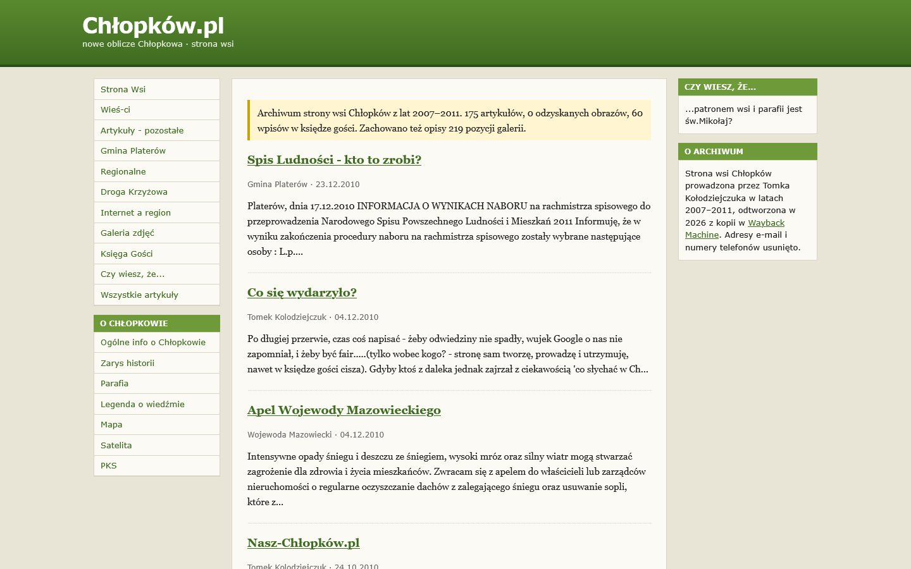

# Chłopków.pl 🏡

**Archiwum strony wsi Chłopków z lat 2007-2011**

Wieś Chłopków, gmina Platerów, powiat łosicki. Strona, którą prowadził Tomek Kołodziejczuk, odtworzona z Wayback Machine. 📜

[🌐 Otwórz archiwum](https://itstomekk.github.io/chlopkow-pl/) · [📰 Wszystkie artykuły](https://itstomekk.github.io/chlopkow-pl/archiwum.html) · [📷 Galeria](https://itstomekk.github.io/chlopkow-pl/galeria.html) · [📖 Księga gości](https://itstomekk.github.io/chlopkow-pl/ksiega-gosci.html) · [🕰️ Oryginał w Wayback](https://web.archive.org/web/2010/http://www.chlopkow.pl/) · [💌 Zgłoś zdjęcie lub wspomnienie](https://github.com/itstomekk/chlopkow-pl/issues/new)

 

---

## 👋 Cześć!

W latach 2007-2011 Chłopków miał własną stronę w internecie: wieści ze wsi, artykuły o gminie i regionie, galeria zdjęć, księga gości, legenda o wiedźmie i rubryka „Czy wiesz, że...”. Potem serwer zniknął.

Ten projekt przywraca to, co się zachowało. Wracają artykuły, księga gości, galeria i ciekawostki. Nie wracają formularze ani adresy e-mail i numery telefonów. Jeśli stąd pochodzisz, masz tu rodzinę albo po prostu lubisz zaglądać do dawnych stron wsi, wejdź. 🧡

## 📦 Co jest w środku

| | |
|---|---|
| 📰 **175 artykułów** | 41 w pełnej wersji, 134 jako wstępy z list. Przy każdym jest link do kopii w Wayback. |
| 📖 **60 wpisów w księdze gości** | Jak w oryginale, bez kontaktów. |
| 💡 **„Czy wiesz, że...”** | 22 wersje modułu z ciekawostkami o wsi. To nie są 22 sprawdzone fakty, tylko to, co wtedy pisała strona. |
| 📷 **219 opisów zdjęć** | Sześć kategorii galerii. **Samych zdjęć nie udało się odzyskać.** |

## 🚧 Na jakim etapie jesteśmy

**Archiwum działa.** Jest opublikowane i można je czytać. Odzyskiwanie trwa, bo wciąż brakuje części materiału:

- ze 134 artykułów mamy tylko wstęp z listy,
- w części pełnych artykułów brakuje obrazków,
- galeria ma opisy, ale nie ma żadnego pliku ze zdjęciem,
- kontaktu i wysyłania artykułów nie odbudowujemy.

Nic nie dopisujemy od siebie. Tam, gdzie coś zginęło, strona to mówi.

## 🤝 Masz stare zdjęcia, strony albo wspomnienia? Pomóż!

To archiwum zyska najwięcej od ludzi, którzy pamiętają Chłopków. Szczególnie szukamy:

- 📷 **zdjęć** z dawnej galerii (opisy mamy, brakuje obrazków) i innych zdjęć wsi z tamtych lat,
- 🕰️ **zapisanych stron**, wydruków i zrzutów ekranu starego chlopkow.pl,
- 🗣️ **wspomnień, poprawek i dopowiedzeń**: kto jest na zdjęciu, co się wydarzyło, jak się to nazywało,
- 🔍 **błędów** w odtworzonych tekstach, nazwach i datach.

**Jak się odezwać:** [otwórz issue](https://github.com/itstomekk/chlopkow-pl/issues/new) w tym repozytorium albo napisz do Tomka przez [profil na GitHubie](https://github.com/itstomekk). Wystarczy kilka słów i link do strony, której dotyczy sprawa.

Prosimy o dwie rzeczy:

1. Wysyłaj zdjęcia i teksty tylko wtedy, gdy masz prawo je udostępnić, i napisz, kto jest autorem.
2. Nie wklejaj w publicznym issue cudzych telefonów, adresów e-mail ani innych prywatnych danych.

## ⚖️ Licencje i prawa autorskie

**Kod** (`build.py`, `safe_html.py`, testy, `validate.py` oraz arkusz stylów i ikona w `assets/`) jest na licencji [MIT](LICENSE).

**Treści archiwum nie są objęte tą licencją.** Prawa do odzyskanych artykułów, zdjęć i wpisów mają ich autorzy. Dotyczy to wygenerowanej strony w `docs/` i danych w `data/`. Nie nadajemy na te treści żadnej licencji.

## 🛠️ Dla programistów

Strona jest statyczna, bez JavaScriptu i bez zależności. Skrypt `build.py` generuje ją z surowych kopii z Wayback do katalogu `docs/`, a GitHub Pages serwuje ją z gałęzi `main`. Jak ją przebudować, uruchomić testy i co jest w `data/` (JSON z artykułami, faktami i galerią): [DEVELOPMENT.md](DEVELOPMENT.md).

---

🇬🇧 In English

An archive of **Chłopków.pl**, the village website of Chłopków (gmina Platerów, Łosice County, Poland), which Tomek Kołodziejczuk ran from 2007 to 2011. The original host is gone; the site was rebuilt from Internet Archive Wayback Machine captures and is live on GitHub Pages: [itstomekk.github.io/chlopkow-pl](https://itstomekk.github.io/chlopkow-pl/).

It holds 175 article records (41 full pages, 134 listing intros), 60 guestbook entries, 22 variants of the "Did you know..." module and 219 gallery captions. No original photo files were recovered. E-mail addresses and phone numbers were removed. Nothing is invented to fill gaps.

If you have old photos, saved pages or memories of Chłopków, please [open an issue](https://github.com/itstomekk/chlopkow-pl/issues/new). The code is MIT licensed ([LICENSE](LICENSE)). Copyright of the recovered material stays with its authors; no license is granted for it. Build notes: [DEVELOPMENT.md](DEVELOPMENT.md).

Zrobione z 🧡 dla Chłopkowa.

